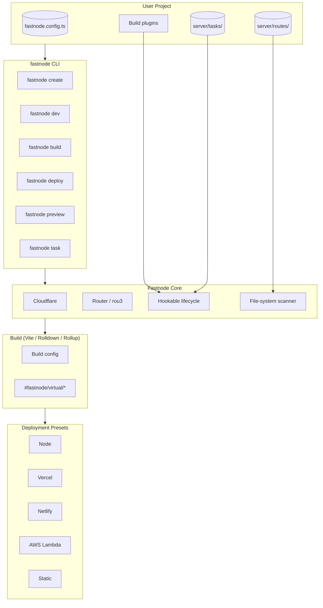

[](https://deepwiki.com/khulnasoft/fastnode)

<p align="center">
  <a href="https://fastnode.khulnasoft.com" target="_blank">
    
  </a>
  <a href="https://www.npmjs.com/package/fastnode" target="_blank">
    
  </a>
  <a href="https://github.com/khulnasoft/fastnode/actions" target="_blank">
    
  </a>
  <a href="https://github.com/khulnasoft/fastnode/blob/main/LICENSE" target="_blank">
    
  </a>
</p>

<h1 align="center">Fastnode</h1>
<p align="center"><b>Framework-agnostic, deployment-agnostic universal JavaScript server.</b></p>

<p align="center">
  Add server routes, prerender pages, run tasks, and deploy <b>anywhere</b> — Node, Vercel, Netlify, Cloudflare, AWS Lambda, Azure, Bun, Deno, and more.
</p>

---

## ✨ What is Fastnode?

Fastnode extends your Vite app with a production-ready server powered by **[H3](https://github.com/h3js/h3) (v2)**, **[UnJS](https://github.com/unjs)** tooling, and **Vite | Rolldown | Rollup**. It gives you filesystem-based API routes, middleware, caching, storage, prerendering, and a zero-config deploy story — all from a single `fastnode.config.ts`.

<details>
<summary><b>📖 Documentation</b></summary>

- **[Docs Site](https://fastnode.khulnasoft.com)** — full guides and API reference
- **[Quick Start](https://fastnode.khulnasoft.com/docs/quick-start)** — get running in minutes
- **[CLI Reference](https://fastnode.khulnasoft.com/docs/cli)** — `fastnode create`, `dev`, `build`, `deploy`, `preview`, `task`

</details>

---

## 🎯 Features

<table>
  <tr>
    <td><b>📁 File-system routing</b></td>
    <td>`server/api/users.ts` → `GET /api/users`. Dynamic, method-suffixed, and environment-filtered routes out of the box.</td>
  </tr>
  <tr>
    <td><b>🚀 Multi-builder</b></td>
    <td>Rollup, Rolldown, Vite, or unbundled (`builder: false`). Pick the bundler that fits your project.</td>
  </tr>
  <tr>
    <td><b>☁️ Deploy anywhere</b></td>
    <td>40+ presets: Node, Vercel, Netlify, Cloudflare, AWS Lambda, Azure, Firebase, Deno, Bun, and static hosts.</td>
  </tr>
  <tr>
    <td><b>🖨️ Prerendering</b></td>
    <td>Crawl and statically generate routes at build time with `fastnode prerender`.</td>
  </tr>
  <tr>
    <td><b>🧩 Framework-agnostic</b></td>
    <td>Works with Vue, React, Solid, Svelte, Elysia, Express, Fastify, Hono, or plain handlers.</td>
  </tr>
  <tr>
    <td><b>⚡ Dev server</b></td>
    <td>Hot module replacement, error recovery overlays, WebSocket proxy, and VFS debugging via `fastnode dev`.</td>
  </tr>
  <tr>
    <td><b>🗄️ Storage & Cache</b></td>
    <td>Key-value storage (`fastnode/kv`), response caching (`fastnode/cache`), and SQL via `fastnode/database`.</td>
  </tr>
  <tr>
    <td><b>📦 Task runner</b></td>
    <td>Background tasks with `fastnode/task` — enqueue and execute server-side jobs.</td>
  </tr>
  <tr>
    <td><b>🔌 Plugins & middleware</b></td>
    <td>Lifecycle hooks, global/routed middleware, and a plugin system for extending the build and runtime.</td>
  </tr>
</table>

---

## 🏗️ Architecture



---

## 🚀 Quick Start

### Option 1: Scaffold a new project

```bash
# npm
npx --min-release-age=0 fastnode@latest create

# pnpm
pnpm dlx --config.minimum-release-age=0 fastnode@latest create
```

Follow the CLI prompts, then:

```bash
cd my-app
pnpm install
pnpm dev   # http://localhost:3000
```

### Option 2: Add to an existing Vite project

Install Fastnode:

```bash
pnpm add -D fastnode vite
```

Wire up the plugin in `vite.config.ts`:

```ts
import { defineConfig } from "vite";
import { fastnode } from "fastnode/vite";

export default defineConfig({
  plugins: [fastnode()],
});
```

Create `fastnode.config.ts`:

```ts
import { defineConfig } from "fastnode";

export default defineConfig({
  serverDir: "./server",
});
```

Add your first route at `server/api/hello.ts`:

```ts
import { defineHandler } from "fastnode";

export default defineHandler(() => {
  return { message: "Hello Fastnode!" };
});
```

Then start the dev server:

```bash
pnpm dev
# → http://localhost:3000/api/hello
```

---

## ☁️ Deploy Targets (Presets)

Fastnode generates framework-agnostic output and adapts it per target via presets.

| Category | Targets |
|----------|---------|
| **Serverless / Edge** | Vercel, Netlify, Cloudflare (Pages / Workers / Durable Objects), AWS Lambda, Azure Functions, Firebase App Hosting |
| **Node hosts** | Render, Railway, Koyeb, DigitalOcean, Upsun, Cleavr, Zeabur, Stormkit, Heroku, IIS, ZeroOps |
| **Runtimes** | Node, Bun, Deno |
| **Static** | GitHub Pages, GitLab Pages, EdgeOne, Alwaysdata, platform.sh |
| **Internal** | `fastnode-dev`, `fastnode-serve`, `fastnode-prerender`, `static` |

Deploy with a single command:

```bash
fastnode build
fastnode deploy   # or fastnode preview
```

See the [full preset list](https://fastnode.khulnasoft.com/docs/cli#presets) in the docs.

---

## 🧩 CLI Commands

| Command | Purpose |
|---------|---------|
| `fastnode create` | Scaffold a new Fastnode project |
| `fastnode dev` | Start the dev server with HMR |
| `fastnode build` | Build for production (Rollup / Rolldown / Vite) |
| `fastnode deploy` | Deploy using the preset's deploy command |
| `fastnode preview` | Preview the production build locally |
| `fastnode task` | List or run server-side tasks |
| `fastnode docs` | Open the documentation site |

---

## 📂 Repository Layout

```
src/
├── core/              # Application, routing, lifecycle
│   ├── application/   # createFastnode, scan, modules
│   ├── routing/       # Router + initFastnodeRouting
│   └── lifecycle/     # Global instance registry
├── build/             # Build system
│   ├── builders/      # rollup, rolldown, vite, unbundled
│   ├── plugins/       # Build-time plugins
│   └── virtual/       # #fastnode/virtual/* templates
├── config/            # Config loader, defaults, resolvers
├── dev/               # Dev server (app, server, vfs)
├── prerender/         # Static prerendering
├── presets/           # Deployment presets (+ runtime)
├── runtime/           # Bundle runtime (app, cache, kv, task…)
├── types/             # Shared TypeScript types
├── utils/             # Internal utilities
├── shims/             # Optional-dependency shims
├── builder.ts         # Public API entry
└── vite.ts            # Vite plugin entry
```

---

## 🛠️ Development

Requires [Node.js ≥ 22.22](https://nodejs.org/en) and [pnpm](https://pnpm.io).

```bash
corepack enable
pnpm install
pnpm build --stub
```

| Script | Description |
|--------|-------------|
| `pnpm dev` | Run the playground dev server |
| `pnpm build --stub` | Fast stub build for development |
| `pnpm build` | Full production build |
| `pnpm lint` | Lint + format check |
| `pnpm fmt` | Auto-fix lint and formatting |
| `pnpm typecheck` | Type-check with `tsc` |
| `pnpm test` | Full test pipeline (rollup + rolldown) |

Bug fixes should include a failing regression test first. See the [Contribution Guide](./CONTRIBUTING.md).

---

## 📄 License

Released under the [MIT License](LICENSE).

---

<p align="center">
  Built with <b>H3 v2</b> · <b>UnJS</b> · <b>Vite</b> · <b>Rolldown</b> · <b>Rollup</b>
</p>
